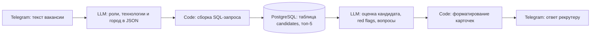

# Candidate Matcher

Telegram-бот на n8n, который подбирает кандидатов из базы под текст вакансии и оценивает каждого из них. Прототип для рекрутера: вместо ручного перечитывания анкет он получает короткие карточки с оценкой, red flags и вопросами для скрининга.

**Стек:** n8n, PostgreSQL, Telegram, LLM через OpenRouter, JavaScript (узлы Code).

> **Статус.** Демонстрационный прототип. Сейчас использует облачные модели через API. Перевод обработки персональных данных на локальные модели планируется.

## Как это работает

1. Рекрутер отправляет боту текст вакансии.
2. Первая LLM извлекает целевые роли и их синонимы, ключевые технологии и город (если нужен офис).
3. Узел Code собирает SQL: кандидаты, у которых роль совпала с должностью, получают приоритет, плюс баллы за каждую совпавшую технологию в тексте резюме. Берутся 5 лучших.
4. Вторая LLM оценивает каждого кандидата по шкале из 10, отмечает red flags (например, нет нужного опыта на целевом стеке или не подходит локация) и формулирует до двух вопросов для созвона.
5. Карточки собираются в одно сообщение и отправляются в чат.

## Состав репозитория

- `workflows/candidate-matcher.json`: сценарий n8n.
- `sql/candidates_schema.sql`: пример структуры таблицы `candidates` (поля выведены из запроса, типы приблизительные).

## Как запустить

1. Установите n8n и импортируйте `workflows/candidate-matcher.json` через *Import from File*.
2. Создайте в n8n свои credentials: Telegram, OpenRouter, PostgreSQL. В репозитории их нет, узлы после импорта покажут, где их указать.
3. Создайте таблицу `candidates` (`sql/candidates_schema.sql`) и загрузите свои резюме.
4. Активируйте сценарий и отправьте боту текст вакансии.

## Известные ограничения и план доработок

- **Облачные модели.** Тексты резюме уходят во внешний API. Для персональных данных нужен локальный запуск моделей.
- **SQL.** Запрос собирается из ответа модели с экранированием кавычек. Нужно перейти на параметризованные запросы.
- **Доступ.** Бот отвечает любому, кто ему напишет. Нужна проверка, что запрос пришёл с разрешённого chat id.
- **Поиск.** Отбор идёт по вхождению подстрок (`ILIKE`). Следующий шаг: полнотекстовый или векторный поиск.

## Что не публикуется

В репозитории нет ключей, идентификаторов credentials и персональных данных кандидатов. `.gitignore` защищает от случайного добавления `.env`, дампов и CSV.
